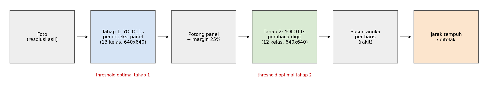
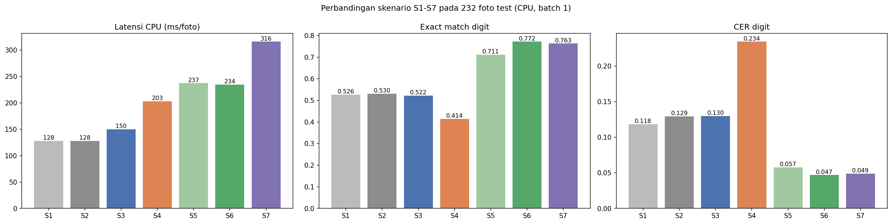

# Pembacaan Jarak Tempuh Odometer Otomatis dengan CNN Dua Tahap (YOLO11)

Proyek Ujian Tengah Semester **Pembelajaran Mendalam**, Semester Ganjil TA 2026-2027
Kelompok **Beda Server**

| NIM | Nama |
|---|---|
| 231113027 | Juvandrew Christnando |
| 231110440 | Edbert Leo Chandra |
| 231112933 | Ahd Yuda Zaki Yamani |
| 231111968 | Abdur Robi Alfian |
| 231111051 | Al Ghazali |

## Tautan

- Aplikasi (Hugging Face Space): _isi link Space_
- Notebook Kaggle (kode + seluruh output): https://www.kaggle.com/code/juvandrew/notebook8f2ca069b6
- Video demo: _isi link video_
- Dataset asli: [Odometer Reading Detection – Roboflow Universe](https://universe.roboflow.com/odometer-dataset/odometer-reading-detection) (CC BY 4.0)

## Ringkasan

Sistem membaca angka jarak tempuh dari foto panel odometer. Proyek ini adalah pengembangan dari Tugas Proyek 1, yang memakai satu model YOLO11s pada foto utuh. Analisis Tugas 1 menunjukkan 68% kesalahan berasal dari digit kecil yang terlewat, sehingga pada UTS sistem dipecah menjadi dua tahap:



1. **Tahap 1:** YOLO11s (13 kelas) mendeteksi panel odometer pada foto utuh. Foto tanpa panel ditolak.
2. Panel dipotong dari foto **resolusi asli** dengan margin 25%. Tinggi digit naik 3,76× (13,9 px → 52,4 px).
3. **Tahap 2:** YOLO11s (12 kelas) membaca digit pada potongan panel.
4. Digit disusun per baris, dari kiri ke kanan, menjadi angka jarak tempuh.

### Fitur unik
1. **Pipeline CNN dua tahap (cascade).**
2. **Optimasi confidence threshold per tahap** dari puncak kurva F1 validasi (tahap 1 = 0,438; tahap 2 = 0,417).
3. **Kompresi ONNX + kuantisasi INT8 selektif.** Layer 0, C2PSA, dan Detect tetap FP32, sehingga model 2,47× lebih kecil dari ONNX FP32 tanpa kehilangan akurasi.

## Hasil (232 foto test, CPU, batch 1)

| Skenario | Ukuran (MB) | Latensi (ms/foto) | Exact match digit | CER digit |
|---|---|---|---|---|
| S1: 1 tahap, PyTorch, conf 0,25 | 19,19 | 128 | 52,6% | 11,83% |
| S2: 1 tahap, PyTorch, conf optimal | 19,19 | 128 | 53,0% | 12,94% |
| S3: 1 tahap, INT8 selektif (**Tugas 1**) | 15,37 | 150 | 52,2% | 12,99% |
| S4: 2 tahap tanpa model tahap 2 | 19,19 | 203 | 41,4% | 23,42% |
| S5: 2 tahap, PyTorch, conf 0,25 | 38,36 | 237 | 71,1% | 5,75% |
| S6: 2 tahap, PyTorch, conf optimal | 38,36 | 234 | 77,2% | 4,68% |
| **S7: 2 tahap, INT8 selektif (UTS)** | **30,74** | **316** | **76,3%** | **4,88%** |

Dibanding Tugas 1, sistem UTS menaikkan *exact match* dari 52,2% menjadi 76,3% (72 foto membaik, 16 memburuk). Kesalahan karena digit kurang turun dari 78 menjadi 16 foto.

Metrik deteksi pada data test:

| Model | Precision | Recall | F1 | mAP50 | mAP50-95 |
|---|---|---|---|---|---|
| Tahap 1 (foto utuh, 13 kelas) | 0,946 | 0,835 | 0,876 | 0,889 | 0,633 |
| Tahap 2 (potongan panel, 12 kelas) | 0,976 | 0,971 | 0,973 | 0,984 | 0,741 |

Recall panel odometer pada tahap 1 = 1,000.



## Struktur repositori

```
app/        aplikasi Gradio (sama dengan yang di-deploy ke Hugging Face)
  app.py
  model/tahap1_panel_int8.onnx
  model/tahap2_digit_int8.onnx
  examples/            3 foto test
  requirements.txt, packages.txt
notebook/   notebook lengkap UTS (Kaggle) beserta output
laporan/    semua gambar (PNG), tabel (CSV), dan hasil_uts.json yang dipakai di laporan
```

## Menjalankan aplikasi secara lokal

```bash
cd app
pip install -r requirements.txt gradio
python app.py
```

Buka alamat yang muncul di terminal (biasanya http://127.0.0.1:7860), unggah foto odometer, dan angka jarak tempuh akan ditampilkan bersama hasil tahap 1 dan tahap 2.

## Teknologi

Python 3.13.16 · Ultralytics YOLO11 8.4.208 · PyTorch 2.11.0 · ONNX 1.23.2 · ONNX Runtime 1.31.1 · OpenCV 4.14.0 · Gradio · Hugging Face Spaces.
Pelatihan: NVIDIA Tesla T4 (Kaggle untuk tahap 2, Google Colab untuk tahap 1 / Tugas 1).
